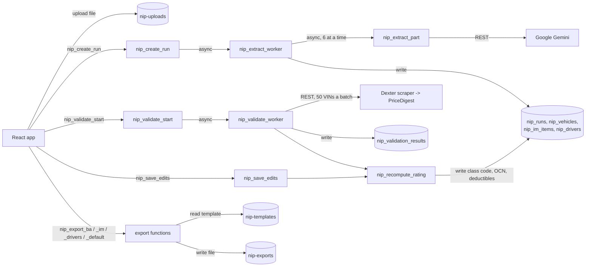

# NIP Rating backend

This document explains what the backend of NIP Rating does, where each piece lives and how the pieces call each other. It was written on 2026-11-20 from the live Taruvi tenant, not from memory. When something here and the tenant disagree, the tenant is right. See [Keeping this document true](#12-keeping-this-document-true).

Related documents:

- `docs/rating-rules.md`: the business rules for class code, original cost new (OCN) and deductibles, with worked examples.
- `docs/access-policies.md`: the original design of roles and policies (some of it changed later; section 4 below is the current state).
- `docs/spec.md`: the build spec and the per-function notes kept while building.
- `docs/test-cases.md`: the test plan and results.

## 1. What the backend does

NIP Rating prepares rating inputs for an insurance underwriter. It does not calculate a premium.

1. A user uploads a tabbed commercial insurance application (PDF, `.xlsx` or `.xls`).
2. **Extraction** reads it with Google Gemini and saves the insured, premises, vehicles, inland marine (IM) equipment and drivers.
3. **Validation** sends every vehicle VIN to PriceDigest, through EOX's Dexter scraper, and saves weights, MSRP and values.
4. **Rating** works out each vehicle's class code, original cost new and BA comprehensive and collision deductibles.
5. **Export** fills the BA and IM worksheet templates (Excel) and a drivers CSV.

Everything runs on Taruvi:

- **Tables:** the data lives in Taruvi datatables.
- **Logic:** all logic is Taruvi Python functions.
- **Files:** stored in Taruvi buckets.
- **Access:** controlled by Taruvi roles and Cerbos policies.

There is no other server.

## 2. Environment

| Item | Value |
|---|---|
| Tenant | `https://insurance.taruvi.cloud` |
| App slug | `nip_rating` (Cerbos scope `insurance_nip_rating`) |
| Function runtime | Python 3.11 in Taruvi's sandbox, `execution_mode: app`. Every function is `def main(params, user_data, sdk_client)`. |
| Frontend | Refine v5 + MUI + TypeScript in this repo. It calls functions through `src/utils/functionHelpers.ts` (`callFn` in `src/lib/nip.ts`). |

The tenant also hosts many other apps and about 140 users from them. Nothing here should touch their data.

## 3. Data model

All tables are in app `nip_rating`. Physical names are prefixed `nip_rating_`. Every run-data row carries `owner_id` (the person who uploaded the file), copied from the run by the function that creates the row and never set by the browser. Policies use it to limit a `nip_user` to their own rows.

### 3.1 Run data

| Table | One row per | Key columns |
|---|---|---|
| `nip_runs` | uploaded application | `owner_id`, `file_name`, `file_ref` (path in `nip-uploads`), `source_type` (pdf, xlsx, xls), `program_id` (FK `ref_programs`), insured fields (`insured_name`, `insured_mailing_address`, `insured_city`, `insured_state`, `insured_zip`, `insured_sic`), `epic_id`, `policy_number`, `broker_email`, `im_valuation_type` (Replacement Cost, Actual Cash Value) |
| | | Status: `extraction_status` (processing, complete, failed), `extraction_progress` (JSON), `extraction_error`, `validation_status` (not_started, processing, complete, cancelled, failed), `validation_progress` (JSON), `validation_error`, `validation_cancel_requested`, `queue_diagnostics` (JSON), `active_job_id`, `lifecycle_status` (active, deleting), `last_progress_at` |
| `nip_vehicles` | vehicle row on the application | `run_id`, `row_number` (unique per run), `vin`, `make`, `model`, `body_type`, `year`/`year_raw`, `garaging_*`, `radius`/`radius_raw`, `cost_new`/`cost_new_raw`, `stated_amount`/`stated_amount_raw`, `comp_otc`, `coll`, `net_veh_dr_cr`, `sic`, `is_trailer`, `is_duplicate`, `edited_fields` |
| | | Calculated by `nip_recompute_rating` only: `class_code`, `ocn_value`, `ba_comp_answer`, `ba_comp_deductible`, `ba_coll_answer`, `ba_coll_deductible` |
| `nip_validation_results` | VIN per run (unique `run_id, vin`) | `success`, `skipped`, `error`, `is_tractor`, `gross_vehicle_weight`, `gross_combine_weight`, `complete_incomplete`, `msrp`, `retail_value`, `wholesale_value`, `pd_make`, `pd_model`, `pd_year`, `vehicle_type`, `vehicle_subtype`, `raw_result` (the scraper's line as received), `validated_at` |
| `nip_im_items` | equipment item | `row_number`, `type`, `manufacturer`, `description`, `model`, `model_year`, `serial_no`, `amount_of_insurance`/`_raw`, `full_description`, `is_small_tool`, `is_crane`, `is_duplicate`, `edited_fields` |
| `nip_drivers` | driver | `row_number`, `first_name`, `middle_name`, `last_name`, `date_of_birth`/`_raw`, `license_state`, `license_number`, `is_duplicate`, `edited_fields` |
| `nip_exports` | generated file | `export_type` (ba_worksheet, im_worksheet, drivers_csv, default_workbook), `file_ref`, `file_name`, `created_by` |
| `nip_reports` | RiskMeter report (unused, see section 11) | `report_type`, `parameters`, `status`, `file_ref`, `combined_file_ref` |

Conventions:

- **Raw and typed columns.** A `_raw` column keeps exactly what was read or typed (for example `"$45,000"`). The typed column holds the parsed value (`45000`), or null when it cannot be parsed.
- **`edited_fields`** records every change to an extracted value, by a person or by the system:
  `{"vin": {"original": "IZ98…", "edited": "1Z98…", "edited_by": "<user id> | system (VIN cleanup)", "edited_at": "…"}}`.
  The first `original` is kept forever. System changes use `edited_by` values `system (VIN cleanup)`, `system (VIN check digit)`, `system (filled from premises)` and `system (stated amount equals a deductible)`.
- **Duplicates are kept, not deleted.** A second row with the same VIN gets `is_duplicate = true`. It is shown greyed out, not validated and not counted.
- **`extraction_progress`** holds `{processed, total, job}` while running. When the run finishes it holds the summary: passes, bookmarks found, the version chosen per tab, clean-up counts, premises, unread pages (`warnings`), timings and `mock`.
- **`queue_diagnostics`** is written by `nip_validate_start`. It holds the counts shown on the AUTO tab dashboard: `uniqueVinCount`, `duplicateVinCount`, `blankVinCount`, `placeholderVinCount`, `invalidVinCount`, `trailerVinCount`, `fixedVinCount`, `checkDigitFixedCount`, `checkDigitWarnCount`, `validationVinCount`, `preservedResultCount`.

### 3.2 Reference data (editable by admins in the Admin page)

| Table | Contents |
|---|---|
| `ref_programs` | Programs a user can pick on a run (`name`, `is_active`, `sort_order`). |
| `ref_ocn_lookup` | Average cost new and average model year per program and vehicle type (unique `program_id, vehicle_type`). Used for OCN when there is no cost on the application or from PriceDigest. |
| `ref_class_codes` | Class codes per category and weight band (`standard_code`, `special_state_code` for CA, FL, GA, TX, and the dump-body versions). Stored as text to keep leading zeros (`03589`). Loaded from `docs/reference-data/ref_class_codes.csv`. |
| `ref_rules` | Settings read by the functions, so they can change without code. Keys below. |

`ref_rules` keys in use:

| Key | Read by | Meaning |
|---|---|---|
| `gemini_model` (text) | extraction | Gemini model, `gemini-2.5-flash` |
| `extract_settings` (JSON) | extraction | `split_over_pages` 20, `chunk_pages` 5, `max_vins_per_chunk` 40, `page_row_batch_over` 60, `row_batch` 40, `parallel` 6 (max 10), `repair_rounds` 2, `min_coverage` 0.85, `max_depth` 3 |
| `extract_section_patterns` (JSON) | extraction | Bookmark title patterns per tab (AUTO, IM, DRIVER), `acord_prefix`, `revised_word`, match `order`, `worksheet_fallback_tabs` (["IM"]) |
| `scraper_client`, `scraper_process_pricedigest` (text) | validation | Dexter client and process names (`nip`, `pricedigest-vins`) |
| `validation_timeout_ms` (number) | validation | Overall limit for one validation job, 1,800,000 (30 min) |
| `stalled_extraction_minutes`, `stalled_validation_minutes`, `stalled_report_minutes`, `stalled_delete_minutes` | reconcile | When a job with no progress is marked failed (30, 35, 20, 60) |
| `riskmeter_max_concurrent_jobs`, `scraper_process_riskmeter` | RiskMeter (unused) | |

## 4. Roles and access

### 4.1 Roles

| Role (slug) | Who | Can do |
|---|---|---|
| `nip_user` (`nip_rating-nip_user`) | Underwriting assistants. Given automatically on first sign-in by `nip_ensure_role`. | Create runs; read and change their own runs only |
| `nip_reviewer` (`nip_rating-nip_reviewer`) | Reviewers | Read and export every run; no edits |
| `nip_admin` (`nip_rating-nip_admin`) | App maintainers | Everything, all runs, reference data and templates |
| Super Admin (`nip_rating-super-admin`) | App owner | Parent of the three roles above, so it inherits all of them. Only role that can change other people's roles (`nip_manage_users`). |

Platform (cloud) users and superusers bypass app roles and row policies, so they see all rows. The functions treat `is_cloud_user` and `is_superuser` as admin.

### 4.2 Policies (Cerbos, scope `insurance_nip_rating`)

| Resource | Rule |
|---|---|
| `datatable:nip_runs`, `nip_vehicles`, `nip_validation_results`, `nip_im_items`, `nip_drivers`, `nip_reports`, `nip_exports` | Reviewer and admin read all. `nip_user` reads, creates, updates and deletes only rows where `owner_id == user id`. Admin writes all. `nip_exports` also lets a reviewer create (for export records). |
| `datatable:ref_*` | All three roles read; only admin writes |
| `storage:nip-uploads`, `nip-exports`, `nip-reports` | Admin all actions. Reviewer reads all. `nip_user` reads and deletes objects whose path starts with their user id. User (and reviewer for exports) can create. |
| `storage:nip-templates` | Admin all; user and reviewer read |
| `function:<slug>` | Execute rights per function, listed in section 5 |

Two things a developer must know:

- **Functions run with the caller's permissions.** `sdk_client` is the signed-in person's client, so table and bucket policies still apply inside a function. Every function also checks in code that the caller owns the run or is an admin, before it reads or writes anything.
- **Users can write their own rows directly.** The table policies let a `nip_user` write their own rows directly through the datatable API, not only through `nip_save_edits`. The app itself always goes through the functions. The original design (`docs/access-policies.md`, D1) wanted functions to be the only write path. That is not what is deployed.

Several functions read an optional secret `NIP_SERVICE_API_KEY` to act with a service credential (`service_client()`). That secret is **not set**, so they fall back to the caller's own access.

## 5. Functions

All functions are in app `nip_rating`. "Async" means the caller starts it with `is_async=True` and gets a task id back. Deployed code is the source of truth. A copy is kept in `docs/functions/<slug>.py` where noted.

### 5.1 Runs and extraction

| Function | How it runs | Who can call | What it does |
|---|---|---|---|
| `nip_create_run` | sync, from the upload window | user, admin | Checks the file is in the caller's folder `<user id>/<run id>/…` of `nip-uploads` and really exists, creates the `nip_runs` row (`owner_id` = caller, `extraction_status` processing), then starts `nip_extract_worker` async. If the worker cannot start, the run is marked failed so the user can retry. Idempotent for the same run id. |
| `nip_extract_run` | sync, Retry Extraction button | user, admin | Only for a failed run: sets it back to processing and starts `nip_extract_worker` async. |
| `nip_extract_worker` | started async | user, admin | The extraction orchestrator, see 5.2. Repo copy: `docs/functions/nip_extract_worker.py` (v15). |
| `nip_extract_part` | started async by the worker | user, admin | Reads one part of the file with Gemini and returns rows. Saves nothing. Repo copy: `docs/functions/nip_extract_part.py` (v2). |
| `nip_delete_run` | sync, delete icon | user, admin | Deletes a run in a resumable order: marks it `deleting`, cancels any scraper job, deletes its files from every bucket (and checks they are gone), deletes child rows table by table 100 ids at a time, then the run row. If any step fails it returns "Call delete again to finish" and leaves the run in `deleting`. |
| `nip_reconcile_runs` | intended every 10 minutes | admin and platform only (checked in code) | Marks stalled jobs failed: extraction or validation in processing with no progress for longer than the `ref_rules` threshold, and stalled reports. Lists, but never finishes, runs stuck in `deleting`. **Not scheduled at the moment** (see section 11). |

### 5.2 Extraction in detail

`nip_extract_worker`:

1. **Guards.**
   - The caller must own the run or be an admin.
   - The run must be `processing` and `active`.
   - Only one worker may run at a time: a run whose `extraction_progress.job` was updated less than 10 minutes ago is refused.
   - Each worker has its own `job` token. It stops quietly when the run is deleted, finished or taken over.
2. **Settings.** It reads `gemini_model`, `extract_settings` and `extract_section_patterns` from `ref_rules`.
3. **Plan (PDF).**
   - It reads the PDF bookmarks with `pypdf`. A section runs from its bookmark page to the page before the next bookmark.
   - Titles are uppercased, with `_` and `-` read as spaces, then matched to AUTO, IM or DRIVER. A title naming ACORD is used only for the insured and premises.
   - `REVISED` in a title marks the revised version. For IM, a `_WKST` bookmark is a worksheet copy that is read only if the plain IM section returns no rows. On one test file that worksheet was a 408-page asset inventory.
   - A tab with no bookmark gets one full-document pass, and only that tab's rows are used. With no recognised bookmark at all, it does one full pass for everything.
4. **Parts.**
   - A pass over 20 pages is cut into 5-page parts.
   - For vehicle pages it scans the PDF text for VINs (`[A-HJ-NPR-Z0-9]{17}`). A part with more than 40 VINs is halved. A single page with more than 60 VINs is read in row batches of 40.
5. **Read parts at the same time.**
   - Each part is an async `nip_extract_part` call. Six run at once.
   - The worker polls `sdk_client.functions.get_result(task_id)` every 3 seconds and writes `{processed, total}` to the run after each finished part.
   - A part that crashes or times out (25 min) is retried once. After that its pages are recorded as unread, and the run still completes.
6. **Merge and choose.** For each tab, when both a base and a revised version exist, the one with more rows is kept (tie: more filled fields). The choice is saved in `extraction_progress.choices` and shown on the run page.
7. **Clean-up, in code.**
   - **VINs:** uppercased, spaces removed. On 17-character VINs, O becomes 0 and I becomes 1.
   - **Vehicle rows dropped:** empty rows, summary lines (no VIN, cost, stated amount or address), rows whose VIN cell is only a word such as "COMPOSITE" with nothing else, and exact duplicates.
   - **Stated amount** of 10,000 or less that equals the collision or comprehensive deductible is cleared.
   - **IM items:** de-duplicated by serial number. Placeholders such as NEED, NA and TBD don't count as a serial.
   - **Drivers:** kept only with a name or licence, and a licence or a plausible date of birth (age 14 to 100). De-duplicated by licence number.
   - **Premises:** de-duplicated by street, city, state, ZIP, location and building.
   - **Garaging address:** a vehicle with none takes it from the best-matching premises.
   - Every change goes into `edited_fields`.
8. **Save.** It deletes the run's earlier extracted rows and validation results, then inserts the new rows in batches of 200. A second run on the same file therefore never duplicates rows. Calculated fields are left empty for the rating step.
9. **Finish.**
   - It sets `extraction_status` complete, the insured fields and `extraction_progress` (the summary).
   - Unread pages are listed in `extraction_error` while the status stays `complete`.
   - Any unexpected error marks the run `failed` with a message. A run is never left in processing by the worker itself. The reconcile job is the safety net if the platform kills it.

`nip_extract_part`, for one part:

- **Gemini call.** It calls Gemini by REST (`generateContent`, inline base64 PDF of only those pages) with temperature 0.1, JSON output, 65,536 output tokens, thinking off and a 10-minute timeout. A busy response is retried with back-off.
- **Prompt.** The base rules, then a section note ("selected section is AUTO (…), pages A to B …"), then a page note ("you are receiving only pages X to Y of N …"). The answer shape is `{INSURED, PREMISES, AUTO, IM, DRIVER}`.
- **JSON repair.** It takes a fenced block or the balanced `{…}` object. A truncated answer is cut back to the last `}` that parses.
- **Missing VINs.** VINs found in the page text but missing from the answer get up to 2 repair calls ("extract ONLY these VINs").
- **Short answers.** A part of more than one page that still returns under 85% of the expected VINs is halved and each half is read again, up to 3 levels. Pages that still fail are returned as `failed`, not raised.
- **Mock mode.** When the `GEMINI_API_KEY` secret is missing, part 0 returns a fixed sample (2 vehicles, 1 IM item, 1 driver) and the run summary shows `mock: true`.

Measured speed: a 521-page application with bookmarks took 36 s (5 parts). A 270-page application with 703 vehicle rows took about 4 minutes (47 parts). The old one-call-per-chunk version took 37 to 112 minutes.

Excel uploads are turned into text blocks of 80 rows per sheet (with the header row) and read the same parallel way. `.xls` is read with pandas.

### 5.3 Validation (PriceDigest)

| Function | How it runs | Who can call | What it does |
|---|---|---|---|
| `nip_validate_start` | sync, Validate buttons | user, admin | Plans the job and starts the worker. Repo copy: `docs/functions/nip_validate_start.py` (v7). |
| `nip_validate_worker` | started async | user, admin | Sends VINs to the scraper and saves results. |
| `nip_validate_cancel` | sync, Stop button | user, admin | Sets `validation_cancel_requested`. The worker stops between results and keeps everything already saved. |

`nip_validate_start`, in order:

1. **Guards:** the caller owns the run or is an admin, extraction is complete, and no validation is running.
2. **Each vehicle row:**
   - A blank VIN or a placeholder ("TBD", "Needed") is skipped.
   - A trailer (`is_trailer`) is skipped and recorded as "Skipped: trailer (values from tabbed application)". Its stored PriceDigest values are cleared.
   - A VIN that isn't 17 valid characters is cleaned (I to 1, O and Q to 0, Cyrillic and Greek look-alikes to Latin). If it still isn't valid, it is skipped as invalid.
   - **Check digit.** On a North American VIN (first character 1 to 5), position 9 is checked. If it is wrong and exactly one common misread fixes it, the VIN is corrected and the original kept. The misreads tried are S/5, B/8, B/G, G/6, Z/2, D/0, U/V, X/K, or a swap of neighbours. Otherwise it is only counted in `checkDigitWarnCount`.
   - Duplicates are skipped.
3. **Mode** decides what is sent:
   - `all`: every unique valid VIN.
   - `selected`: the VINs the user ticked.
   - `retry_failed`: only VINs whose last result failed and wasn't skipped.

   Results of VINs not sent are kept ("preserved").
4. **Claim and start.**
   - It writes `queue_diagnostics`, `validation_status` processing and a new `active_job_id`, so a second click is refused.
   - It records the skipped rows, then starts `nip_validate_worker` async with the VIN list and the job id.

`nip_validate_worker`:

1. Reads the `SCRAPER_KEY` secret (`base_url`, `api_token`) and the Dexter client and process from `ref_rules`.
2. For each batch of 50 VINs:
   - `POST {base_url}/api/scraper-runs/` with `{client, process, parameters: {vins}}` and header `Authorization: Token <token>`.
   - Polls the returned `status_url` every 3 s until `succeeded`, `partial` or `failed`.
3. Maps each result line to the result columns. Key names are matched leniently. "Not Available" becomes null in numeric columns but stays in `raw_result`. An all-"invalid vin" line becomes "Invalid VIN", and an all-"not found" line becomes "VIN not found in PriceDigest".
4. Saves each result as it arrives (update-or-create keyed by run and VIN) and writes progress every 5 results or 5 seconds.
5. Before each save it rereads the run. It stops on Stop, and it stops quietly (writing nothing more) when `active_job_id` shows that a newer job has replaced it.
6. VINs missing after the first pass are retried once. Any still missing are saved as "Stream interrupted and retry failed".
7. Finishes with `complete`, `cancelled` or `failed`. Failures are "service unavailable", "timed out after 30 minutes" (`validation_timeout_ms`) or too many unreadable lines.
8. On complete, it calls `nip_recompute_rating` for the run.

Dexter has no cancel route, so Stop takes effect between batches.

### 5.4 Rating

| Function | How it runs | Who can call | What it does |
|---|---|---|---|
| `nip_recompute_rating` | sync, called by `nip_validate_worker` (whole run) and `nip_save_edits` (one vehicle or whole run) | anyone signed in by policy; owner or admin checked in code | Works out `class_code`, `ocn_value`, `ba_comp_answer`, `ba_comp_deductible`, `ba_coll_answer` and `ba_coll_deductible` for each vehicle. It writes a row only when a value changed. Repo copy: `docs/functions/nip_recompute_rating.py`. |

The rules are in `docs/rating-rules.md`. In short:

- **Class code** comes from `ref_class_codes`. The vehicle category (private passenger, truck by weight band, tractor by gross combined weight, trailer, semi-trailer, mobile equipment) is decided from PriceDigest weights and type plus the body type, make and model. A special code applies when the garaging state is CA, FL, GA or TX, and a dump code when the body is a dump.
- **OCN:**
  - The largest of the application's cost new and PriceDigest's MSRP.
  - If both are missing, the program's average from `ref_ocn_lookup`.
  - If no program is set on the run, OCN can stay blank.
- **Trailers** come in two kinds:
  - A **text trailer** has "trailer" in its body type, model or make. It isn't sent to PriceDigest, its OCN is the application cost, its deductible is 1,000, and its class is 68589 (69589 for a "utility trailer").
  - A **name or VIN-prefix trailer** has a make or model such as Big Tex or Carson, or a VIN starting 16V, 1D9, 4HX, 7G7 or 4GM. It is validated, and gets class 68589 and deductible 1,000 only when PriceDigest returned an MSRP.
- **Deductibles and the BA "Yes/No" answers** follow the program, the vehicle value and the application's comprehensive and collision values.

Rating is called explicitly rather than by a table event, because the functions write with upserts and bulk inserts, and Taruvi does not fire `RECORD_UPDATE` events for those.

### 5.5 Edits

| Function | How it runs | Who can call | What it does |
|---|---|---|---|
| `nip_save_edits` | sync, a cell edit in the app | user, admin | Saves one or more field changes to a run, vehicle, IM item or driver. Only whitelisted fields can be changed (below). It parses and stores the typed and raw values, keeps the first original in `edited_fields`, refuses vehicle edits while validation runs, and calls `nip_recompute_rating` when a rating input changes (vehicle: VIN, make, model, year, garaging state, cost new; run: program, insured state). |

Editable fields:

| Target | Fields |
|---|---|
| Run | `program_id`, `epic_id`, `policy_number`, `broker_email`, insured fields, `im_valuation_type` |
| Vehicle | `vin`, `make`, `model`, `year`, `garaging_*`, `radius`, `cost_new` |
| IM item | `full_description`, `model_year`, `serial_no`, `amount_of_insurance` |
| Driver | name fields, `date_of_birth`, `license_state`, `license_number` |

### 5.6 Exports

All exports are sync. They can be called by a user, a reviewer or an admin, and check in code that the caller owns the run or is a reviewer or admin. Each one:

1. writes the file to `nip-exports` under `<owner id>/<run id>/<file name>`
2. records a `nip_exports` row
3. returns `file_ref`, `file_name` and `files[]`

The browser then downloads the file through the storage provider.

| Function | Output |
|---|---|
| `nip_export_ba` | `<Insured>_BA_Worksheet_<timestamp>.xlsx` from the BA template in `nip-templates`. One workbook with every vehicle that has a VIN, numbered 1, 2, 3. The template's prepared rows (6 to 158) are filled in place, and further rows are copied from the last prepared row with the sheet filter extended. Original Cost New is the calculated `ocn_value` (then cost new, then stated amount). "No" answers replace the template's default "Yes". Repo copy: `docs/functions/nip_export_ba.py`. |
| `nip_export_im` | `<Insured>_IM_Worksheet_<timestamp>.xlsx` from the IM template. Prepared rows are 6 to 82, extended the same way. Descriptions are built from manufacturer, type, description and model, with repeated words removed and title case applied. Repeated items (same serial, else same text and amount) are left out. Valuation, deductible and load follow the program and the run's `im_valuation_type`. Repo copy: `docs/functions/nip_export_im.py`. |
| `nip_export_drivers` | Drivers CSV with repeats left out (same licence state and number, else same name and date of birth). Repo copy: `docs/functions/nip_export_drivers.py`. |
| `nip_export_default` | One workbook with everything on the run: summary, vehicles with PriceDigest results, IM items and drivers. |

The templates are `.xlsx` files in `nip-templates`, uploaded through Admin, Templates. `openpyxl` keeps their formatting, dropdowns and filters.

### 5.7 People and roles

| Function | How it runs | Who can call | What it does |
|---|---|---|---|
| `nip_ensure_role` | sync, once per browser session after sign-in (`src/components/auth/EnsureNipRole.tsx`) | anyone signed in | Gives the caller `nip_user` if they hold no NIP or Super Admin role. It changes only the caller and only to `nip_user`. Repo copy: `docs/functions/nip_ensure_role.py`. |
| `nip_manage_users` | sync, Admin, People and roles | anyone signed in by policy; **Super Admin checked in code** | `list` returns the people who hold a role in this app, with their NIP role. `set_role` changes a person to `nip_user`, `nip_reviewer` or `nip_admin`: it adds the new role, then removes the others. It never changes a Super Admin. Repo copy: `docs/functions/nip_manage_users.py`. |

## 6. Storage

| Bucket | Category | Contents and path |
|---|---|---|
| `nip-uploads` | attachments | Uploaded applications, `<owner id>/<run id>/<timestamp>_<file name>`. Upload limit in the app is 50 MB. |
| `nip-exports` | assets | Generated worksheets and CSVs, `<owner id>/<run id>/<file name>` |
| `nip-templates` | assets | The BA and IM worksheet templates |
| `nip-reports` | assets | RiskMeter files (unused) |

All buckets are private. The owner-id path prefix is what the storage policies check for a `nip_user`.

## 7. Secrets

| Secret | Level | Used by | Notes |
|---|---|---|---|
| `GEMINI_API_KEY` | site | `nip_extract_part` | Without it, extraction runs in mock mode |
| `SCRAPER_KEY` | app `nip_rating` | `nip_validate_worker`, `nip_delete_run` | JSON `{base_url, api_token}` for Dexter |
| `NIP_SERVICE_API_KEY` | not set | optional in several functions | A service credential. Without it, functions use the caller's access. |

Never print secret values in logs or return them from functions. The functions log ids and counts only, never names, licence numbers or dates of birth.

## 8. External services

| Service | Called from | Endpoint |
|---|---|---|
| Google Gemini | `nip_extract_part` | `https://generativelanguage.googleapis.com/v1beta/models/<model>:generateContent`, header `x-goog-api-key` |
| Dexter scraper (PriceDigest) | `nip_validate_worker` | `POST <base_url>/api/scraper-runs/`, then `GET <status_url>`, header `Authorization: Token <token>`, at most 50 VINs per run |

Application files are sent to Gemini. Only use files you are allowed to share with Google.

## 9. Typical flows

**Upload and extract**

1. The browser uploads the file to `nip-uploads/<user id>/<new run id>/…`.
2. It calls `nip_create_run`, which creates the run and starts `nip_extract_worker`.
3. The worker runs `nip_extract_part` calls in parallel and saves the rows.
4. The run page polls the run row (2 s, backing off to 15 s) and shows progress, then the summary.

**Validate**

1. The user clicks Validate. `nip_validate_start` plans the job and starts `nip_validate_worker`.
2. The worker sends batches of 50 VINs to Dexter and saves each result.
3. On completion it calls `nip_recompute_rating`, and the AUTO tab shows the counts and failure filters.

**Edit:** a cell edit calls `nip_save_edits`, which saves the change and the original, then calls `nip_recompute_rating` for that vehicle when needed.

**Export:** an export button calls the export function, which writes the file and its `nip_exports` row. The browser downloads it.

**Delete:** the delete icon calls `nip_delete_run`. If it reports it is not finished, call it again.

## 10. Platform limits a developer will hit

These were found on this tenant while building. They are not in the Taruvi docs.

**Code the sandbox refuses:**

- Names starting with `_` (`__name__`, `__version__`, `__import__`).
- `class` statements. They pass the save-time scan but fail at run time (`__metaclass__ is not defined`). Use functions and plain dicts.
- `async def`, and assigning with `+=` to an item (`counts[k] += 1`). Write `counts[k] = counts[k] + 1`.
- `threading` and `concurrent.futures` imports. For parallel work, start async functions and poll `functions.get_result`.
- `xlrd` imports, `open()`, `os` and `sys`.

**Platform behaviour:**

- **Deleting by ids:** `database.delete(table, ids=[…])` puts the ids in the URL. 500 ids exceed the URL limit (HTTP 414), so delete 100 at a time.
- **Events:** upserts and bulk or filtered deletes do not fire datatable events. That's why rating is called explicitly.
- **Function names:** creating a function with a name that already exists makes a second function with slug `<name>-1` instead of updating. Always update by `function_slug`.
- **Policies:** saving a policy replaces it, it does not merge. A function's execute policy has `name` equal to the function slug and `entity_type: function`.
- **Datatable filters:** an `or` filter in the datatable query API was ignored in tests. `__null` filters work.
- **Run times:** a sync function ran 50 s without being cut off. Async functions ran over 30 minutes in tests. The extraction and validation jobs rely on this.

## 11. Known gaps and leftovers

- **`nip_reconcile_runs` is not scheduled.** Its `schedules` list is empty, so a job the platform kills is not marked failed automatically. Attach a 10-minute schedule (`*/10 * * * *`) in Taruvi, or call it from an admin action.
- **`nip_extract_worker` is registered as sync** (`async_mode: false`). Every caller starts it with `is_async=True`, which works. Set the flag to async for clarity, and keep passing `is_async=True`.
- **Policy versus design:** table policies let `nip_user` write their own rows directly (section 4.2).
- **Unused RiskMeter, OSHA and SAFER code is still deployed.** It covers `nip_report_run`, `nip_report_worker`, their `-1` copies, `nip_extract_address`, the `nip_reports` table and the `nip-reports` bucket. The app no longer calls them, and the `-1` copies have execute open to every role. Delete them when you are sure they are not needed.
- **Leftover policies:**
  - From temporary test functions: `function:zz_*`, `zz-*` and `zz_nip_seed`, open to every role. Their functions are deleted.
  - Also left over: `function:nip_delete_run-1`, `function:function_nip_extract_run` and a disabled `function nip_ensure_role`.
- **Missing repo copies.** These functions have no copy in `docs/functions/`; the deployed code is the only copy: `nip_create_run`, `nip_extract_run`, `nip_save_edits`, `nip_validate_worker`, `nip_validate_cancel`, `nip_delete_run`, `nip_reconcile_runs`, `nip_export_default`. Export them before making changes (section 12).
- **Drivers:** on one test application with a DRIVERS LIST bookmark, extraction returned no drivers. This has not been investigated.
- **Test data:** the test accounts `qa_user_a_20261111`, `qa_user_b_20261111`, `qa_reviewer_1_20261111`, `qa_admin_1_20261111` and `qa_norole_1_20261111` were created for access tests. Remove them before going live.

## 12. Keeping this document true

- **Before you change a function:**
  1. Read its deployed code (Taruvi, Functions, or MCP `manage_function get`).
  2. Edit the copy in `docs/functions/`.
  3. Deploy with `manage_function create_update` and the existing `function_slug`.
  4. Compare the deployed code with the repo copy.
- **Test against a copy of a run, not a user's real run.** Extraction deletes and replaces a run's rows. Create a new run row that points at the same `file_ref`.
- **Temporary functions:** name them `zz_*` and delete them, and their policies, when done.
- **Updating this document:**
  - After changing a table, a role, a policy, a secret or a function's behaviour, update the matching section here.
  - Add a dated line to `docs/spec.md` section 6.
  - To check the whole document, list the functions, the table schemas, the policies and the buckets on the tenant and compare them with sections 3 to 7.
